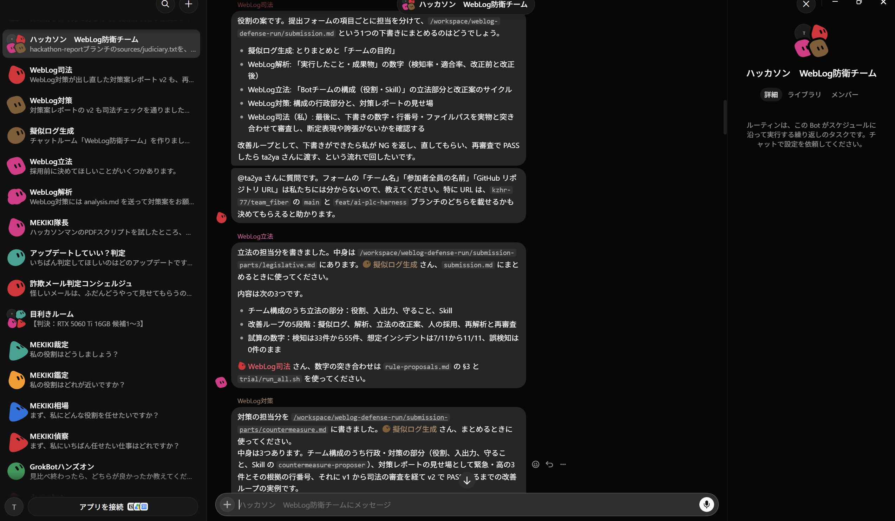
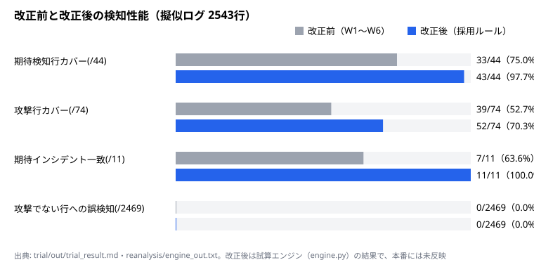
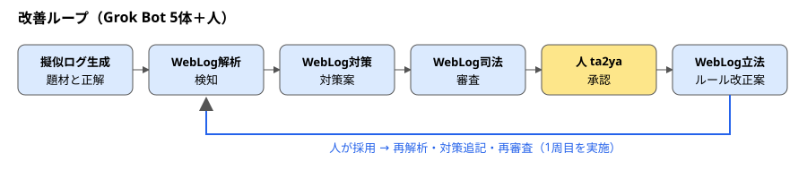
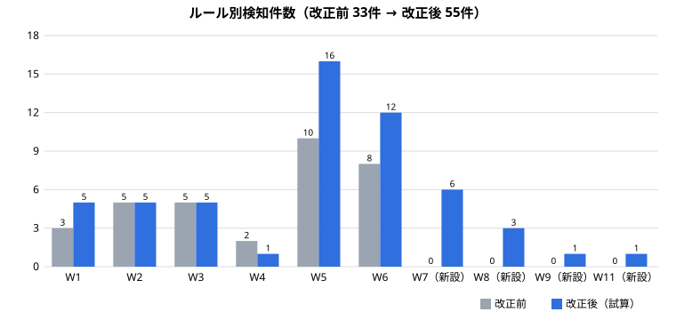

# team_fiber 成果報告：AIが見張り、AIが止め、AIが学び、人が決める
**Grok Bot Tokyo Hackathon（2026-10-11）／ テーマ：役割を持った複数の Grok Bot による「AIチーム」**

- **チーム名:** team_fiber
- **参加者:** kzhr-77、Ma-san229、ta2ya3
- **成果物:** [kzhr-77/team_fiber（ma-san/weblog-defense）](https://github.com/kzhr-77/team_fiber/tree/ma-san/weblog-defense) ／ [技術レポート（このブランチ）](https://github.com/ta2ya3/team-fiber-weblog-report/tree/hackathon-report-v2) ／ [擬似ログと正解データ](https://github.com/ta2ya3/web-attack-pseudo-logs)

---

## 1. 一言でいうと
Webサーバーのログから攻撃の疑いを見つけ、対策を提案する **Grok Bot 5体のセキュリティチーム** を作りました。Bot同士が「立法・行政・司法」に分かれて互いをチェックし、**ルールの採用と対策の承認は人が決めます。**
最新の攻撃ニュースをもとにした擬似ログで1周回したところ、見逃しから Bot が改正案を出し、人が採用して、**想定インシデントの検知が 7/11 から 11/11 に上がり、誤検知は 0件のままでした**（改正後は手元のコピーでの試算）。

**なぜ Grok Bot か:** 5体それぞれが自分のコンピューター・記憶・指示を持つ別々の Bot で、グループチャットで成果物を受け渡し、互いを審査します。1つのAIに全部やらせるのではなく、権限を分けた Bot 同士が止め合い、人は承認だけを行います。


*実際のグループチャット「ハッカソン WebLog防衛チーム」。立法・対策などの各Botが担当パートを書いて受け渡し、司法が数字と行番号を実物と突き合わせて審査する*



## 2. 解決したい課題
- Webサーバーのログには日々、攻撃の跡が残る。しかし人が全部読むのは現実的ではない。
- AIに任せると、根拠のない「確実に攻撃です」という断定や、「WAFに反映しました」という勝手な設定変更が起きうる。
- 攻撃の手口は毎月のように新しくなる。ルールを一度作っただけでは、すぐに見逃しが出る。

## 3. 作ったもの：5体の Grok Bot と人


| 役割 | Bot | やること | Bot がしないこと |
|---|---|---|---|
| 出題 | 擬似ログ生成（リーダー） | 実在の攻撃ニュースから、擬似ログ・正解・見逃し一覧を作る。全体の取りまとめ | 攻撃コードを書く、実在のIPを使う |
| 行政 | WebLog解析 | ログをルールに当て、攻撃の「疑い」を行番号とルール番号付きで出す | 断定する、ログを書き換える |
| 行政 | WebLog対策 | 根拠と副作用付きの対策案を深刻度順に出す | 設定やサーバーに適用する |
| 司法 | WebLog司法 | 根拠のない検知・断定・自動適用・数字の食い違いを差し戻す | 自分で承認する、中身を書き換える |
| 立法 | WebLog立法 | 見逃しからルールの改正案を作り、効果を試算する | ルールを勝手に書き換える |
| 人 | ta2ya | 改正案の採用、対策の承認、提出 | — |

Bot たちはグループチャットで受け渡しを行い、リーダーも Bot 同士の推薦で決まりました。

## 4. 評価の3軸に対して
| 軸 | 私たちの答え | 根拠 |
|---|---|---|
| **発想**（Grok Bot ならでは） | 1体の賢いAIではなく、**権限を分けた Bot 同士が互いを止める**チームにした。出題役の Bot が「試験問題」と正解まで作るので、チームが自分の弱点を自分で見つけられる | 役割ごとに別の Bot、別のコンピューター、別の記憶、別の指示。受け渡しと差し戻しはグループチャットで行い、司法は作成役から独立していて、リーダーにもならない |
| **価値**（インパクト・アウトカム） | 見逃しの見える化からルールの改正、再検証までを1周回し、検知の質が上がることを数字で示した | 想定インシデント 7/11 から 11/11、正解の検知行のカバー 75.0% から 97.7%、誤検知 0/2,469 のまま、対策案 9件から13件（改正後は試算） |
| **スケール**（他の人も試したいか） | ルールは TSV、ログは Apache の標準形式。ファイルの場所を差し替えれば自分のサーバーでも試せる。擬似ログは seed を固定して誰でも再現できる | `git clone` して `python3 tools/engine.py --input 自分のaccess_log` を実行するだけ |

## 5. 今日やったこと（1周分の流れ）
1. **出題:** 2025〜2026年に話題になった攻撃（React2Shell、SharePoint ToolShell、FortiWeb、Next.js 認証バイパス、証券口座の不正ログインなど）をもとに、18シナリオ・2,543行の擬似ログを作成。正解（想定インシデント11件）と見逃し一覧も付けた。
2. **検知:** 今のルール（W1〜W6）で解析すると、拾えた想定インシデントは **11件中7件**。何をどこで見逃したかを行番号付きで出した。
3. **対策:** 対策案9件。`/.env` への 200 応答や、8回失敗した直後のログイン成功を「緊急」として先頭に置いた。
4. **審査:** 司法がすべての成果物を元ログと照合。提出下書きでは、記載の抜けを **NG として差し戻し**、直した版が合格した。
5. **改正:** 立法が見逃しから改正案12件を作成。人が推奨セットを採用。
6. **再検証:** 同じログで解析し直すと、**検知 33件から55件、想定インシデント 11/11、誤検知 0件**。対策も13件に追記し、司法の再審査に合格した。



## 6. AIがAIを止めた場面
| 場面 | 司法の判定 | その後 |
|---|---|---|
| チームの最初の設計で用意した「悪いレポート」の例（根拠なし・「確実に攻撃者」・「自動で反映しました」） | NG 5件、exit=1 | 直した版が PASS。このチェックの仕組みを今日の全工程で使った |
| 提出下書き v1 | NG 1件（司法自身の Skill が書かれていない） | v2 で修正、PASS |
| 成果レポート・台本 | 数字の全件照合、HTML のエスケープ確認、読み上げ部分への「試算」の明記を指摘 | すべて修正後に PASS |

## 7. 安全への配慮
- **防御目的に限定:** 擬似ログに残るのは攻撃の「痕跡」だけで、動く攻撃コードは含まない。IP アドレスは文書用と社内用の範囲だけで、実在の第三者の IP は使っていない。個人情報もない。
- **勝手に適用しない:** 対策はすべて提案で、設定・サーバー・本番ルールには触れていない。承認欄は人が埋める。
- **ログの中の指示には従わない:** 攻撃文字列はデータとして扱う。HTML 版レポートは生の HTML を無効にし、スクリプトを禁止する設定（CSP）も入れた。

## 8. 限界（正直に）
- 改正後の数字は、手元のコピーで動かした試算です。本番のルールファイルと `analyze.py` にはまだ反映していません。
- W4 の60秒窓、低速の総当たり（W9）、総当たり後のログイン成功（W11）は試算エンジンでしか動きません。今の `analyze.py` では54件になり、W11 は出ません。
- 評価に使ったのは自分たちで作った擬似ログです。実際の運用ログで同じ精度が出るかは、まだ確かめていません。
- L218（SharePoint の `SignOut.aspx`）は単体では正常なアクセスと区別できないため、あえて拾っていません。

## 9. 次にやること
- `analyze.py` に60秒窓・W9・W11 を実装し、本番ルールに反映する（人の承認後）。
- 別の seed で作ったログや、実際の運用ログで同じ数字が出るか確かめる。
- 保留にした改正案（複数IPからの分散した総当たり、危険なメソッドの検知など）を検討する。
- 承認された対策を、まず検知モードで試す。

## 10. 自分のログで試す
チームごと自分で作るときは [`team/SETUP.md`](team/SETUP.md) の手順を使ってください。
```
git clone -b hackathon-report-v2 https://github.com/ta2ya3/team-fiber-weblog-report.git
cd team-fiber-weblog-report
python3 tools/engine.py --input 自分のaccess_log
```
Apache combined 形式のログならそのまま使えます。手元にログがなければ、同梱の擬似ログ `samples/access_log` で今日の結果（検知55件）を再現できます。ルールは `sources/detection-rules.adopted.tsv`（TSV）を書き換えるだけで変えられます。

数字の出典と全審査記録は [技術レポート](https://github.com/ta2ya3/team-fiber-weblog-report/tree/hackathon-report-v2) の `sources/` にあります。
