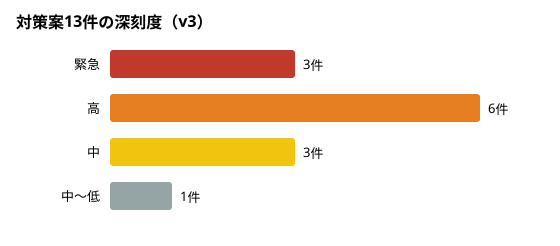
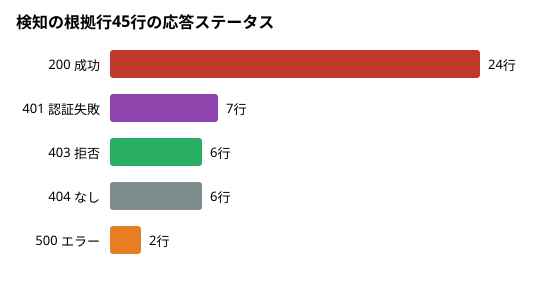

# Webアクセスログ攻撃検知・対策提案チーム 成果レポート

- **チーム名:** team_fiber
- **イベント:** Grok Bot Tokyo Hackathon（2026-10-11）
- **参加者:** kzhr-77、Ma-san229、ta2ya3
- **成果物:** [kzhr-77/team_fiber（ma-san/weblog-defense ブランチ）](https://github.com/kzhr-77/team_fiber/tree/ma-san/weblog-defense) ／ 擬似ログ・正解データ [ta2ya3/web-attack-pseudo-logs](https://github.com/ta2ya3/web-attack-pseudo-logs)
- **人間用の見やすい版:** `report.html`（ブラウザで開く）

## 1. 要約
Grok Bot 5体が「立法・行政・司法」の三権分立で役割を分け、互いの成果物をチェックしながら Web アクセスログの攻撃検知と対策提案を行いました。最後の判断は人が行います。2025〜2026年に実際にニュースになった攻撃をもとにした擬似ログ（2,543行）で1周回したところ、次のようになりました。

| 指標 | 改正前 | 改正後（人が採用したルール） |
|---|---:|---:|
| 検知件数 | 33 | 55 |
| 正解の検知行のカバー | 33/44（75.0%） | 43/44（97.7%） |
| 想定インシデントとの一致 | 7/11 | 11/11 |
| 攻撃でない行への誤検知 | 0 | 0 |
| 対策案 | 9件 | 13件 |
| 司法の審査 | — | 全成果物 PASS（NG 0件、`check.sh` exit=0） |

改正後の数字は手元のコピーで動かした試算です。本番のルールファイルと `analyze.py` にはまだ反映していません（詳しくは「6. 注意点」を参照）。

## 2. チーム構成と改善ループ

| Bot | 役割 | 主な成果物 | Skill |
|---|---|---|---|
| 擬似ログ生成 | 実在の攻撃ニュースをもとに、擬似ログ・正解・検知漏れ一覧を作る。全体のとりまとめ | `access_log`, `expected_report.json`, `missed_attacks.md`, 本レポート | `tools/generate_logs.py`（seed を固定して再現できる） |
| WebLog解析（行政） | ルールに当てて攻撃の「疑い」を行番号とルール番号付きで出し、正解と照合する | `analysis.md`, `gap.md`, `reanalysis.md` | `skills/log-analyzer` |
| WebLog対策（行政） | 対策「案」を深刻度順に作る。適用はしない | 対策レポート v1〜v3 | `skills/countermeasure-proposer` |
| WebLog司法 | R10〜R12 と `check.sh` で、根拠のない検知・断定・自動適用を差し戻す | `judiciary.txt` | `judiciary/check.sh`、行番号と数値の全件照合 |
| WebLog立法 | 検知漏れからルールの改正案を作り、効果を試算する | `rule-proposals.md`, 採用ルール | `ai-dev-hotl-governance` |
| 人（ta2ya） | 改正案の採用と、対策の最終承認 | — | — |

## 3. 題材：最新の攻撃ニュースをもとにした擬似ログ
IP アドレスは文書用の範囲だけを使い、攻撃コードは含めていません。ログに残る痕跡だけを再現しています。

| ID | シナリオ | 元ネタ | 改正前のルールでの判定 |
|---|---|---|---|
| S01 | 古典的SQLインジェクション(クエリ) | [出典](https://scan.netsecurity.ne.jp/article/img/2025/02/19/52357/47549.html) | 検知 |
| S02 | 反射型XSS(クエリ) | [出典](https://owasp.org/www-community/attacks/xss/) | 検知 |
| S03 | ディレクトリトラバーサル(FortiWeb型+古典) | [出典](https://www.cisa.gov/news-events/alerts/2025/11/14/fortinet-releases-security-advisory-relative-path-traversal-vulnerability-affecting-fortiweb) | 検知 |
| S04 | 設定ファイル・管理画面偵察(.git/.env) | [出典](https://www.greynoise.io/blog/spike-git-configuration-crawling-risk-codebase-exposure) | 検知 |
| S05 | リスト型ブルートフォース(高速) | [出典](https://www.fsa.go.jp/ordinary/chuui/chuui_phishing.html) | 検知 |
| S06 | SharePoint ToolShell経路の偵察/悪用痕跡 | [出典](https://securelist.com/toolshell-explained/117045/) | 検知 |
| S07 | React2Shell関連スキャナー偵察 | [出典](https://www.trendmicro.com/en/research/25/l/CVE-2025-55182-analysis-poc-itw.html) | 検知 |
| S08 | 二重URLエンコードによるSQLi/XSSすり抜け | [出典](https://owasp.org/www-community/Double_Encoding) | すり抜け |
| S09 | 二重エンコードトラバーサルすり抜け | [出典](https://www.picussecurity.com/resource/blog/fortiweb-cve-2025-64446-vulnerability-path-traversal-leads-to-remote-code-execution) | すり抜け |
| S10 | 低速ブルートフォース(60秒超) | [出典](https://www.sankei.com/article/20250707-DYCZEVVIP5LC5IALPCY3LO5OYE/) | すり抜け |
| S11 | 分散ブルートフォース(複数IP) | [出典](https://xtech.nikkei.com/atcl/nxt/mag/nc/18/020600014/082700210/) | すり抜け |
| S12 | Next.js Middleware認可バイパス(ヘッダ) | [出典](https://github.com/vercel/next.js/security/advisories/GHSA-f82v-jwr5-mffw) | すり抜け |
| S13 | React2Shell RCE(POST本文) | [出典](https://isc.sans.edu/diary/32572) | すり抜け |
| S14 | Citrix Bleed 2 メモリリーク試行 | [出典](https://www.bleepingcomputer.com/news/security/citrix-bleed-2-exploited-weeks-before-pocs-as-citrix-denied-attacks/) | すり抜け |
| S15 | FortiWeb Fabric Connector SQLi(Authorizationヘッダ) | [出典](https://labs.watchtowr.com/pre-auth-sql-injection-to-rce-fortinet-fortiweb-fabric-connector-cve-2025-25257/) | すり抜け |
| S16 | Apache Tomcat partial PUT RCE痕跡 | [出典](https://www.greynoise.io/blog/active-exploitation-critical-apache-tomcat-rce-vulnerability-cve-2025-24813) | すり抜け |
| S17 | sqlmapによるSQLi | [出典](https://sqlmap.org/) | 検知 |
| S18 | 正常ログイン(打ち間違い後成功) | [出典](https://github.com/kzhr-77/team_fiber/issues/13) | 正常 |

## 4. 解析
### 解析（WebLog解析）

### 何をしたか
擬似ログ `access_log`（Apache combined 形式、2543行）を検知ルールに当て、攻撃の疑いを行番号（L）とルール番号（W）つきで出しました。期待値（`expected_report.json`・`access_log.meta.jsonl`）と照合し、検知漏れと期待値とのずれを立法に、検知結果を対策に渡しています。

### 改正前と改正後
| 指標 | 改正前（W1〜W6, `analyze.py`） | 改正後（採用ルール, `trial/engine.py`） |
|---|---:|---:|
| 検知件数 | 33 | 55 |
| 期待検知行のカバー（/44） | 33（75.0%） | 43（97.7%） |
| 攻撃行のカバー（/74） | 39（52.7%） | 52（70.3%） |
| 攻撃でない行への誤検知（/2469） | 0 | 0 |
| 期待インシデントとの一致（/11） | 7 | 11 |

改正後に検知した行は、重複を除くと52行で、すべて攻撃行でした。

### 新しく拾えた攻撃の疑い
| ルール | 根拠の行 | 内容 |
|---|---|---|
| W1 変更 | L50, L499 | UNION ALL SELECT、EXTRACTVALUE を使う SQL インジェクションの疑い |
| W5/W6 変更 | L135, L246–249 | nuclei の UA、`/actuator/env` の探索の疑い |
| W7 新設 | L100, L217, L219, L220, L248, L249 | FortiWeb・SharePoint ToolShell・Next.js RSC など既知の脆弱製品のパス探索の疑い |
| W8 新設 | L280, L281, L302 | 多重 URL エンコードの疑い |
| W9 新設 | L323–328 | 60秒窓の外で行われた低速の総当たりの疑い（198.51.100.30） |
| W11 新設 | L175 | 8回の失敗の直後のログイン成功の疑い |

### 注意点
- 改正後の数字は手元のコピー（`trial/adopted/detection-rules.adopted.tsv`）を使った結果で、本番のルールと `analyze.py` にはまだ反映していません。
- W4 の60秒窓・W9・W11 は `trial/engine.py` でしか動きません。同じルールを `analyze.py` で回すと54件になり、W11 は出ません。本番で使うには `analyze.py` の改修が必要です。
- 拾えていない期待検知行は L218（SharePoint の `SignOut.aspx`）の1行だけです。単体では正常なアクセスと区別できないため、意図的に対象外にしています。
- 検知の表記はすべて「〜の疑い」です（R11）。

再現: `python3 trial/engine.py --input /workspace/pseudo-logs/access_log --rules trial/adopted/detection-rules.adopted.tsv`

## 5. 立法：ルールの改正
### 立法：検知ルールの改正（採用済み・試算のみ、本番は未反映）

運用で見つかった漏れから改正案を作り（RULES.md R8）、ta2ya さんが推奨セットの採用を決めました。採用したルールは作業用コピー `trial/adopted/detection-rules.adopted.tsv` にあり、本物の TSV は変えていません。

| ルール | 改正内容 | 改正前 | 改正後 | 新たに拾った根拠行 |
|---|---|---|---|---|
| W1 SQLインジェクションの疑い | UNION ALL・EXTRACTVALUE・@@version 等を追加 | 3 | 5 | L50, L499 |
| W2 XSSの疑い | 変更なし | 5 | 5 | — |
| W3 パストラバーサルの疑い | 変更なし | 5 | 5 | — |
| W4 総当たり（高速）の疑い | 仕様どおり「60秒以内に5回以上・ユーザー名2種以上」に修正 | 2 | 1 | （L323–328 は W9 へ移動） |
| W5 スキャナの疑い | nuclei・gobuster・ffuf 等を追加 | 10 | 16 | L127, L135, L246–249 |
| W6 機密パス探索の疑い | `/.aws/`・危険な actuator・`.bak`/`.sql` を追加 | 8 | 12 | L130, L131, L135, L136 |
| W7 既知脆弱製品パス探索の疑い | 新設（SharePoint・FortiWeb・Next.js RSC） | 0 | 6 | L100, L217, L219, L220, L248, L249 |
| W8 多重URLエンコードの疑い | 新設 | 0 | 3 | L280, L281, L302 |
| W9 総当たり（低速）の疑い | 新設（15分窓） | 0 | 1 | L323–328 |
| W11 総当たり後の認証成功の疑い | 新設 | 0 | 1 | L175 |
| **合計** | | **33** | **55** | |

- 想定インシデントとの一致は 7/11 から 11/11 に、正解の検知行のカバーは 33/44 から 43/44 になりました。攻撃でない行への誤検知は 0件のままです。
- あわせて R11 に合わせ、ルール名をすべて「〜の疑い」にそろえました。
- W4 の60秒窓・W9・W11 は試算エンジン `trial/engine.py` でのみ動きます。本番の `analyze.py` では54件になり、W11 は出ません。本番で使うには `analyze.py` の改修が必要です。
- 不採用・保留の案（W10 分散総当たり、W12 危険メソッド、Citrix 等のパス追加）は `rule-proposals.md` に残しています。

## 6. 対策
### 対策（行政）パート：対策案レポート v3 の要約

元レポート: `/workspace/weblog-defense-run/report.md`（v3。v1・v2 は `report.v1.md`・`report.v2.md`）
審査: WebLog司法 で v1・v2・v3 とも PASS（NG 0件、`check.sh` exit=0）。承認: 人の承認が必要（未）

### 対策案の深刻度

### 検知の根拠行は、どれだけ「通って」いるか
改正後ルールの検知55件の根拠行（W9 は L323〜L328 の6行を含めて数えた重複なし45行）を、元ログの応答ステータスで分けた。半数以上の24行が 200 で、攻撃が通った疑いがあるものから優先して対策を並べた。

### 対策案一覧（深刻度順）
| # | 深刻度 | W番号 | 根拠 | 対策の要点 | 副作用 |
|---|---|---|---|---|---|
| 1 | 緊急 | W6・W5 | L127, L129, L131, L133（200） | 機密ファイルの実在確認、資格情報の作り直し、ドットファイルを 404 固定、phpMyAdmin のアクセス元制限 | 正規の管理アクセスを止める恐れ |
| 2 | 緊急 | W4 | L167〜L174 の 401 後、L175 で 200 | アカウント確認、`/login` のレート制限と一時ロック、多要素認証 | 正規ユーザーのロック |
| 10 | 緊急 | W11 | L175 | W11 を即時通知にして、セッション無効化を人が判断 | 打ち間違い後の成功でも通知される |
| 3 | 高 | W7 | L217〜L220（200、L219 は 49733B） | SharePoint の運用確認、未使用なら `/_layouts/` を 404 固定 | 運用中なら機能停止 |
| 4 | 高 | W1・W8 | L47〜L50, L280, L499 | WAF を検知モードで試してからブロック、クエリのプレースホルダ化 | 正規クエリの誤ブロック |
| 5 | 高 | W3・W8 | L101, L102, L302（200） | パスの正規化と `..` 拒否、ダウンロードは許可リスト方式 | 正規ファイル名の拒否 |
| 6 | 高 | W2・W8 | L76〜L79（200）, L281 | WAF の XSS ルール、出力エスケープ確認、CSP（まず Report-Only） | 正規入力の誤検知 |
| 11 | 高 | W7 | L100, L217〜L220, L248, L249 | FortiWeb・SharePoint・Next.js の棚卸しと更新状況の確認 | 使用中の製品パスを止めると業務停止 |
| 12 | 高 | W8 | L280, L281, L302 | URL デコードは1回だけにし、デコード後に `%` が残る入力を拒否 | `%` を含む正規入力の拒否 |
| 7 | 中 | W5・W6 | L125〜L136, L246〜L249 | スキャナ UA は監視中心、診断元 IP の許可リスト | 正規の診断を止める恐れ |
| 8 | 中 | W4・W9 | L323〜L328, L349〜L356 | 全 IP 合計とアカウント単位のしきい値 | しきい値次第で誤検知 |
| 13 | 中 | W9 | L323〜L328 | アカウント単位の段階的な遅延、CAPTCHA・多要素認証 | 嫌がらせ目的のロックアウト |
| 9 | 中〜低 | 仕様外 | L382, L383, L468 など | 内部 API のアクセス元制限、PUT の拒否、ログ項目の追加 | 内部連携の停止 |

### 改善ループ（対策から見たもの）
1. v1: 解析の検知33件から対策9件を作成 → 司法 PASS、任意の改善点2つ
2. v2: ToolShell の根拠に応答サイズ、XSS を期待値どおり「高」に → 司法 PASS
3. v3: 人が立法の改正案を採用 → 再検知55件、W7・W8・W9・W11 分の対策10〜13を追記 → 司法 PASS

注: W4 の60秒窓・W9・W11 は試算エンジン `trial/engine.py` の結果で、`analyze.py` では未対応。どの対策も提案のみで、設定やサーバーには反映していない。

## 7. 司法の審査記録
| 対象 | 結果 |
|---|---|
| 対策レポート v1 | PASS（任意の改善点2つ） |
| 対策レポート v2 | PASS |
| 提出下書き v1 | NG 1件（司法の Skill が書かれていない）→ v2 で修正 → PASS |
| 対策レポート v3・再解析・提出下書き v3 | PASS（NG 0件。55件の検知は立法と解析で1行も違わない） |
| 本レポート（README.md・report.html） | PASS（NG 0件。グラフ6枚の数字が元データと一致、HTMLのエスケープとCSPを確認） |

全記録は [`sources/judiciary.txt`](sources/judiciary.txt) にあります。

## 8. 注意点と今後
- 改正後のルールは手元のコピー（[`sources/detection-rules.adopted.tsv`](sources/detection-rules.adopted.tsv)）にだけ反映しています。W4 の60秒窓・W9・W11 は試算エンジンでしか動かないため、本番で使うには `analyze.py` の改修が必要です（今の `analyze.py` では54件になり、W11 は出ません）。
- 対策13件はすべて提案で、設定やサーバーには何も反映していません。

承認: 人の承認が必要（未）
